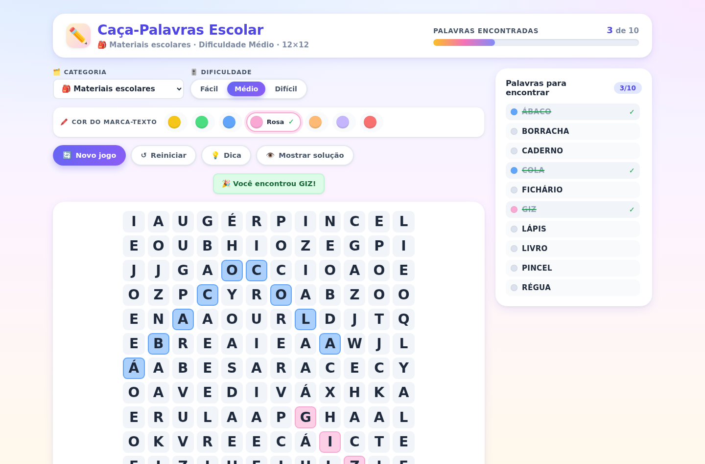
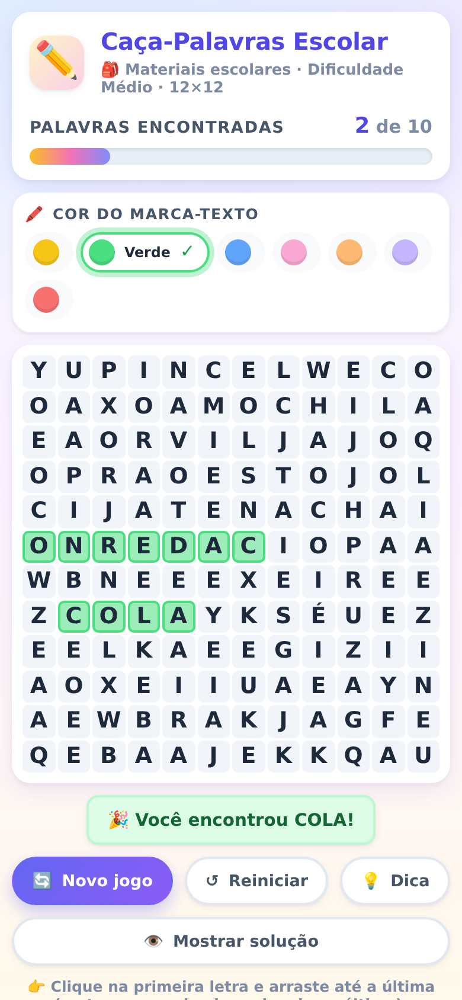
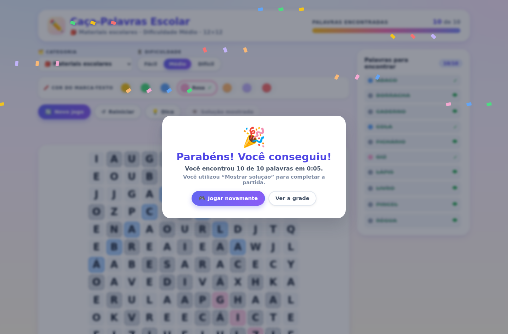

# ✏️ Caça-Palavras Escolar Interativo

Jogo de caça-palavras com palavras do ambiente escolar, feito para crianças, estudantes e
professores. A grade é **gerada automaticamente**, a seleção funciona com **mouse e toque** e cada
palavra encontrada é marcada com a **cor do marca-texto escolhida pelo jogador**.

📄 **Requisitos de produto completos (escopo, personas, RF/RNF, regras de negócio, matriz de
rastreabilidade e roadmap) em [`PRD.md`](PRD.md).**



---

## 🚀 Como executar

```bash
# 1. instalar as dependências
npm install

# 2. iniciar o servidor de desenvolvimento
npm run dev
```

Depois abra o endereço mostrado no terminal (por padrão **http://localhost:5173**).

Para gerar a versão de produção:

```bash
npm run build      # gera a pasta dist/
npm run preview    # serve a build em http://localhost:4173
```

### Todos os comandos

| Comando             | O que faz                                                        |
| ------------------- | ---------------------------------------------------------------- |
| `npm install`       | Instala as dependências                                          |
| `npm run dev`       | Sobe o servidor de desenvolvimento (http://localhost:5173)         |
| `npm run build`     | Verifica os tipos e gera o build de produção em `dist/`           |
| `npm run preview`   | Serve o build de produção (http://localhost:4173)                  |
| `npm run typecheck` | Verifica os tipos sem gerar arquivos                             |
| `npm test`          | Testes unitários da lógica do jogo (Vitest)                       |
| `npm run test:e2e`  | Testes end-to-end no Chrome real (Puppeteer)                      |

> O `test:e2e` usa o Google Chrome do sistema (`/usr/bin/google-chrome`). Se o Chrome estiver em
> outro caminho, defina `CHROME_PATH=/caminho/do/chrome npm run test:e2e`.

---

## 🎮 Como se joga

1. Escolha a **categoria** (materiais escolares, disciplinas, profissionais da escola, espaços,
   atividades ou variadas) e a **dificuldade** (Fácil, Médio, Difícil).
2. Escolha a **cor do marca-texto** no painel colorido (amarelo, verde, azul, rosa, laranja, roxo
   ou vermelho). Pode trocar a qualquer momento, inclusive no meio da partida.
3. **Arraste** da primeira letra até a última da palavra — nas 8 direções — ou **toque** na
   primeira letra e depois na última.
4. Ao soltar, o jogo valida a seleção:
   - palavra certa → marca as células na cor escolhida e risca a palavra na lista;
   - palavra errada → a seleção é desfeita e um aviso aparece.
5. Encontre todas as palavras para receber a mensagem de parabéns!

### Controles

| Botão                | O que faz                                                                 |
| -------------------- | ------------------------------------------------------------------------- |
| **Novo jogo**        | Gera outra grade com outras palavras e posições                           |
| **Reiniciar**        | Limpa as marcações e mantém a mesma grade                                 |
| **Dica**             | Faz piscar **uma única letra** de uma palavra ainda não encontrada         |
| **Mostrar solução**  | Revela as palavras restantes com marcações cinza tracejadas (encerra a rodada) |
| **Categoria**        | Troca o tema das palavras (gera nova partida)                              |
| **Dificuldade**      | Troca o tamanho da grade e a quantidade de palavras (gera nova partida)     |

Quando existe progresso, as ações que apagam as marcações pedem **confirmação** antes de
continuar.

---

## 🧩 Como o jogo funciona

### Geração da grade (`src/lib/wordSearch.ts`)

- Cada rodada sorteia palavras da categoria escolhida respeitando o tamanho máximo de palavra da
  dificuldade (Fácil: ≤ 7 letras, Médio: ≤ 9, Difícil: ≤ 12).
- As palavras são posicionadas **ao acaso** nas 8 direções (→, ←, ↑, ↓ e as 4 diagonais),
  da mais longa para a mais curta, com centenas de tentativas por palavra.
- Duas palavras podem **compartilhar a mesma letra** (a célula é reaproveitada somente quando a
  letra é a mesma, ignorando acentos).
- Se uma palavra não couber, o motor **tenta outras posições** e, persistindo, **gera outra grade**.
- Os espaços livres são preenchidos com **letras aleatórias** (alfabeto ponderado, com mais
  vogais).
- Ao final, o motor **remove palavras do banco que surgiram por acaso** no preenchimento, para que
  o jogador nunca encontre uma palavra que não está na lista.
- `verifyRound()` garante que **toda palavra exibida na lista está realmente na grade** — isso é
  verificado em todos os testes.

### Acentos (`src/lib/normalize.ts`)

MATEMÁTICA, CIÊNCIAS, PORTUGUÊS, FÍSICA, ÁBACO… funcionam normalmente. Toda comparação interna
usa a forma normalizada (sem acentos, maiúscula, sem espaços), então a busca funciona **mesmo que a
grade use letras sem acento** — e a grade exibe o acento quando a palavra foi posicionada com ele.

### Seleção (`src/lib/selection.ts` + `src/components/WordSearchGrid.tsx`)

- Um único código de interação atende **mouse e toque** (Pointer Events).
- Durante o arraste, a seleção é **projetada na reta mais próxima** entre as 8 direções, então o
  dedo não precisa percorrer a palavra exatamente.
- Ao soltar, as letras selecionadas são comparadas com a lista da rodada. Letras aleatórias nunca
  são marcadas.

### Cores (`src/lib/colors.ts`)

Cada cor é aplicada como uma mancha translúcida com borda colorida, mantendo a letra escura e
legível. A cor usada é **gravada no momento em que a palavra é encontrada** — trocar o marca-texto
depois **não altera** as palavras já marcadas.

---

## 🧪 Como testar

### 1. Teste manual (no navegador)

```bash
npm install
npm run dev        # abra http://localhost:5173
```

Checklist sugerido para validar no navegador:

| # | O que fazer | O que esperar |
| --- | --- | --- |
| 1 | Arraste de uma letra até a outra, em linha reta | A palavra é marcada na cor escolhida e riscada na lista |
| 2 | Arraste na diagonal, de baixo para cima e da direita para a esquerda | Funciona igual (8 direções) |
| 3 | Arraste letras que não formam palavra | Aviso de erro, nada é marcado, a grade treme |
| 4 | Troque a cor **com** palavras já encontradas | As antigas **mantêm** a cor original; a nova entra na cor escolhida |
| 5 | Toque na primeira letra e depois na última (celular/tablet) | A palavra é encontrada |
| 6 | "Dica" | Apenas **uma letra** pisca por ~3 s |
| 7 | "Mostrar solução" | Palavras restantes em cinza tracejado + tela de parabéns |
| 8 | "Reiniciar" | Marcações limpas, **mesma grade** |
| 9 | "Novo jogo" | Outra grade e outra lista (pede confirmação se houver progresso) |
| 10 | Troque a categoria/dificuldade | Nova partida correspondente (10×10, 12×12 ou 14×14) |
| 11 | Redimensione a janela para 360 px e para 1920 px | Sem rolagem horizontal; a grade se adapta |
| 12 | Recarregue a página (F5) | Cor, categoria e dificuldade mantidas |

> Para testar o **toque** no computador, abra o DevTools (F12) → ícone de celular (📱) → ative
> "Device mode" e escolha um celular.

### 2. Testes automatizados

```bash
npm test          # 46 testes unitários da lógica (geração, seleção, acentos)
npm run test:e2e  # 17 testes no Chrome real (mouse, toque, botões, layout)
```

Para acompanhar os testes unitários em tempo real: `npm run test:watch`.

---

## 📁 Estrutura do projeto

```
├── index.html
├── package.json
├── vite.config.ts
├── vitest.config.ts
├── scripts/
│   ├── e2e.test.mjs        # testes end-to-end no Chrome (mouse, toque, botões)
│   └── screenshot.mjs      # gera as imagens de conferência
└── src/
    ├── main.tsx
    ├── App.tsx             # composição da tela e confirmações
    ├── hooks/
    │   └── useGame.ts      # estado da partida, validação, dica, solução
    ├── lib/
    │   ├── types.ts        # tipos do domínio
    │   ├── normalize.ts    # acentos e comparações
    │   ├── colors.ts       # paleta do marca-texto
    │   ├── wordBank.ts     # banco de palavras e categorias
    │   ├── wordSearch.ts   # motor de geração da grade
    │   ├── selection.ts    # projeção das linhas de seleção
    │   └── __tests__/      # testes unitários
    ├── components/
    │   ├── WordSearchGrid.tsx   # grade interativa
    │   ├── WordList.tsx         # lista de palavras
    │   ├── ColorPicker.tsx      # paleta do marca-texto
    │   ├── ControlBar.tsx       # botões de controle
    │   ├── CategorySelect.tsx
    │   ├── DifficultySelect.tsx
    │   ├── ProgressBar.tsx
    │   ├── Toast.tsx
    │   ├── WinOverlay.tsx       # modal de parabéns
    │   └── ConfirmDialog.tsx
    └── styles/global.css
```

**Tecnologias:** React 18 + TypeScript + Vite, com CSS puro (sem bibliotecas de UI).
Dependências de produção: apenas `react` e `react-dom`.

---

## ✅ Testes

```bash
npm test          # 46 testes unitários
npm run test:e2e  # 17 testes end-to-end no navegador real
```

Os testes unitários cobrem: normalização de acentos, busca nas 8 direções, palavras com letras
compartilhadas, geração válida em todas as categorias × dificuldades, ausência de duplicatas,
distribuição das direções e limite de comprimento das palavras.

Os testes end-to-end (Chrome real) cobrem: arraste com o mouse, seleção por toque em tela de
celular, modo “toque na primeira e depois na última”, troca de cor durante a partida e **manutenção
da cor original** das palavras já encontradas, botão de novo jogo, reiniciar, dica, mostrar
solução, confirmações, mensagem de vitória, e o layout em telas de 360 px, 390 px, 1280 px e
1920 px — sem erros no console.

---

## 📸 Telas

| Desktop | Celular | Vitória |
| ------- | ------- | ------- |
|  |  |  |

---

## 📝 Observações

- As preferências (cor, categoria e dificuldade) ficam salvas no `localStorage` do navegador.
- O jogo respeita `prefers-reduced-motion` (as animações são desligadas para quem pede menos
  movimento).
- Ajustes de acentos: toda a comparação de palavras ignora acentos, maiúsculas e
  espaços, garantindo consistência entre a lista e a grade.
